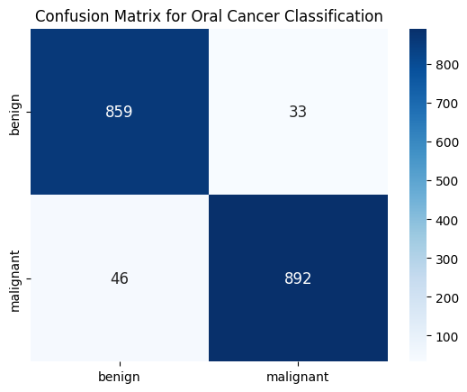

# Oral Health Scanner — oral lesion screening on mobile

A Flutter app that takes a photo of an oral lesion and classifies it as **benign** or **malignant**. The model is a MobileNetV2 that runs on the phone (TFLite). Scans are saved to Supabase per user, and a small Python pipeline pulls those scans back to fine-tune the model and push a new TFLite file.

This is a screening prototype, not a diagnostic tool.



## How it fits together

```
app/ (Flutter)
  camera / gallery → resize → TFLite MobileNetV2 → result screen
  auth + scan history → Supabase (Postgres + Storage)

pipeline/ (Python, runs server-side)
  main.py: cleanup → download scans → download current model
           → fine-tune → convert to TFLite → upload both back to Supabase

training/
  mobilenetv2_training.ipynb   main experiment (150px, frozen backbone then full unfreeze at epoch 15)
  train_mobilenetv2_224.py     alternative run: 224px, class weights, two-stage fine-tune
  predict.py                   single-image prediction

preprocessing/
  split_dataset.py             70/15/15 split, seed 42
  lesion_segmentation.py       CLAHE (LAB) + k-means lesion mask + bounding box
```

## Results

From the notebook, on its held-out test set (1830 images):

| | precision | recall | f1 | n |
|---|---|---|---|---|
| benign | 0.95 | 0.96 | 0.96 | 892 |
| malignant | 0.96 | 0.95 | 0.96 | 938 |
| **accuracy** | | | **0.96** | 1830 |

Malignant recall is 892/938, so 46 malignant lesions were called benign. For a screening tool that's the number to push down, more than overall accuracy.

The `f1_score` printed during training (~0.35) is wrong: it's a batch-level Keras metric with a shape broadcast bug. Use the sklearn report above.

### Read this before quoting the 96%

The Mendeley *Oral Images Dataset* has **165 benign and 158 malignant original images**. The rest of the folder is augmented copies (flips, rotations, resizes) of those same images. The notebook trained on about 9.5k images, so it either used the augmented set or a different source. If augmented copies were split *after* augmentation, versions of the same lesion end up in both train and test, and the 96% is inflated. The honest next step is to split by original image first, augment only the training set, and re-run.

## Dataset

Chandrashekar H S et al., *Oral Images Dataset*, Mendeley Data, v2, 2021. DOI: [10.17632/mhjyrn35p4.2](https://data.mendeley.com/datasets/mhjyrn35p4/2). Images were collected from hospitals in Karnataka, India, with mobile and intraoral cameras. The dataset isn't redistributed here. Put it in `data/original/{benign_lesions,malignant_lesions}` and run `preprocessing/split_dataset.py`.

## Running it

**Model weights** are in the Releases tab. Put `oral_cancer.tflite` in `app/models/`, and `oral_cancer.h5` in `models/` if you want to use `training/predict.py`.

**App**

```bash
cd app
flutter pub get
flutter run --dart-define=SUPABASE_URL=https://<project>.supabase.co \
            --dart-define=SUPABASE_ANON_KEY=<anon key>
```

Create the table with `supabase/schema.sql`, plus a storage bucket called `oral-cancer-images`. Turn on Row Level Security so users only see their own rows.

**Pipeline**

```bash
pip install -r requirements.txt
cp .env.example .env   # fill in, uses the service-role key
cd pipeline && python main.py
```

## Known problems

- **The fine-tune loop trains on its own predictions.** `download_supabase_images_labelled.py` labels every scan with whatever the model predicted, then `fine_tune_model.py` trains on those labels. That reinforces the model's mistakes instead of fixing them. Images need a clinician-confirmed label before they go back into training.
- **Label mismatch.** The model was trained on *benign lesion* vs *malignant lesion*, but the app labels say *Normal* vs *Oral Cancer*. A benign lesion isn't "normal", so the UI text should say what the model actually knows.
- **Scans are stored at public URLs.** `getPublicUrl()` is used for medical photos. They should be in a private bucket with signed URLs.
- **Input size isn't pinned.** The notebook trains at 150px and the alternative script at 224px. The app reads the size from the model, but the pipeline hardcodes 150.
- No patient-level split and no external test set (see above).

## TODO

- split before augmenting, re-evaluate
- clinician-in-the-loop labelling before fine-tuning
- private storage + signed URLs
- tune the decision threshold for malignant recall, not accuracy

## Team

<!-- TODO: names + who did what -->
